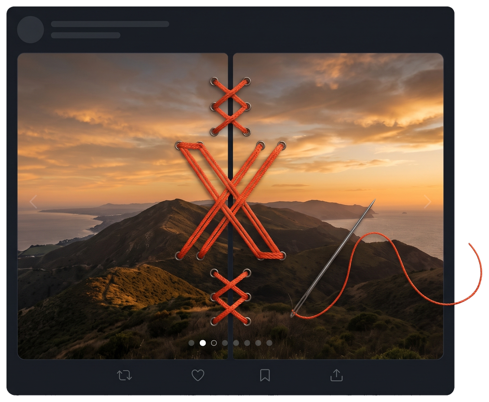

<h1 align="center">x-stitch</h1>

<p align="center">
  <em><b>Turn split X carousels back into one full-resolution image.</b></em><br>
  Pass a post URL, get one stitched image back — no API key, no manual alignment.
</p>

<p align="center">
  
  
</p>

<p align="center">
  
</p>

## Why?

Designers and photographers on X routinely split panoramas, ultrawide wallpapers,
and tall strips across several carousel images to work around feed cropping. Saving
each slice at `name=orig` and stitching them together by hand gets old fast.
`x-stitch` downloads every segment at original resolution in parallel and joins
them back into a single JPEG.

## Highlights

- 🧵 **Full-resolution segments.** Rewrites every media URL to `name=orig`
  before downloading.
- ⚡ **Parallel downloads.** Fetches all segments concurrently over a shared
  HTTP client with timeouts.
- 🔑 **No account or API key.** Resolves post metadata through
  `api.fxtwitter.com`.
- 🔗 **Forgiving URL parsing.** Works with `x.com`, `twitter.com`, `mobile.*`,
  `fxtwitter.com`, `vxtwitter.com`, `fixupx.com`, `/i/web/status/...`, and
  links with `/photo/1` or tracking parameters.
- ↕️ **Horizontal or vertical.** Stitches left-to-right by default, or
  top-to-bottom with `--vertical`.
- 📦 **Resilient batch mode.** Pass multiple URLs in one run — a deleted or
  photo-less post won't abort the rest.
- 🏷️ **Traceable files.** Embeds the canonical post URL in the JPEG `COM`
  comment marker so renamed wallpapers stay linked to their source.

## Install

Requires a Rust toolchain (minimum version: `rust-version` in `Cargo.toml`):

```sh
cargo install --path .
```

## Usage

```sh
# Save to current directory as <user>-<status_id>.jpg
x-stitch https://x.com/user/status/1234567890

# Save with a custom filename (saves as panorama.jpg)
x-stitch https://x.com/user/status/1234567890 -n panorama

# Custom filename and output directory
x-stitch https://x.com/user/status/1234567890 -n panorama -o ~/Pictures/Wallpapers

# Batch multiple posts into one folder
x-stitch <url-1> <url-2> -o ~/Pictures/Wallpapers

# Stitch vertically instead of horizontally
x-stitch <url> --vertical

# Lower JPEG quality or skip source URL metadata
x-stitch <url> -q 90 --no-metadata
```

## Options

| Option | Default | What it does |
| --- | --- | --- |
| `<URLS>...` | (required) | One or more X/Twitter status URLs |
| `-o, --out <DIR>` | `.` | Output directory (created automatically if missing) |
| `-n, --name <NAME>` | `<user>-<id>.jpg` | Custom output filename (single URL only; `.jpg` appended if omitted) |
| `-q, --quality <1-100>` | `95` | JPEG quality of the stitched image (unused for a single JPEG photo) |
| `--vertical` | `false` | Stitch segments top-to-bottom instead of left-to-right |
| `--no-metadata` | `false` | Omit the source X URL from the JPEG `COM` comment marker |

## Good to know

- **Inspecting source metadata:** By default, the canonical URL
  (`https://x.com/<user>/status/<id>`) is written into a standard JPEG `COM`
  segment right after `APP0`. Read it back anytime with:
  ```sh
  magick identify -format '%c\n' <file>
  # or
  exiftool -Comment <file>
  ```
- **Batch failures:** When given multiple URLs, errors are printed to `stderr`
  while the remaining posts still run. The process exits non-zero if any URL
  failed.
- **Overwriting:** Writing to a path that already exists replaces the file.
- **Re-encoding:** Stitching decodes every segment and encodes the result as
  one JPEG, so the output is full resolution but not byte-identical to the
  segments X serves.
- **Single-photo posts:** A JPEG is saved exactly as X serves it, with only the
  `COM` comment added. Any other format is re-encoded as JPEG.
